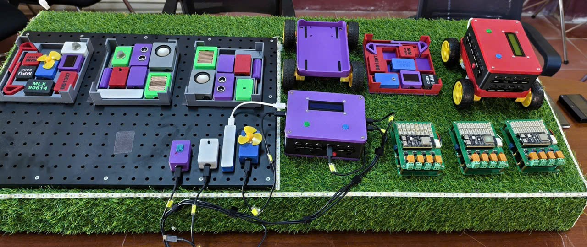
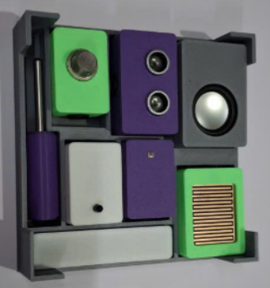
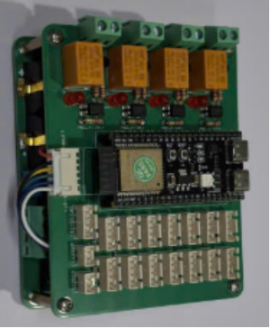
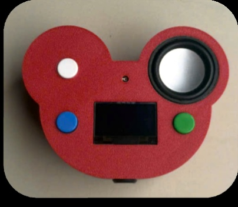

# EduMaker STEMKit

**Award:** 3rd Prize, Final Round, Students with Startup Ideas Competition (SV.STARTUP 2026).

**Role:** Specified the board requirements (ESP32-S3, labeled sensor ports). My teacher and a third party supported the circuit side, designing the PCB and milling it on a desktop CNC. Designed and 3D printed the casing. Wrote the code and designed both sample projects. Built the companion Android app. Set up the companion chatbot on the Xiaozhi platform.

I built EduMaker STEMKit to help students learn programming and robotics through hands-on building instead of just theory. Instead of one fixed circuit, I designed it as a set of snap together blocks (sensor, controller, display, AI unit) that combine into different builds. I also built two sample projects, a remote control car and a smart home, so students have ready-made projects to learn from.

## What it is

I made two versions for two different stages of learning:

| Version     | What it looks like          | Who it's for                                                              |
| ----------- | --------------------------- | ------------------------------------------------------------------------- |
| **Starter** | Bare board, wires exposed   | Students still learning the hardware itself: wiring, pin layout, raw code |
| **Comfort** | Same board, 3D printed case | Students who already know the hardware and want to focus on the software  |

*What the sensor blocks look like taken apart*

## Hardware

| Component          | Function                                        |
| ------------------ | ----------------------------------------------- |
| ESP32-S3           | Main controller (center of the board)           |
| DHT11              | Temperature and humidity                        |
| DS18B20            | Temperature (one-wire)                          |
| MLX90614           | Infrared (contactless) temperature              |
| Heart rate sensor  | Pulse sensing                                   |
| MPU6050            | Accelerometer / gyroscope                       |
| RTC module         | Real time clock                                 |
| Gas sensor         | Gas detection (analog input)                    |
| Fire sensor        | Flame detection (analog input)                  |
| Rain sensor        | Rain detection (analog input)                   |
| LDR                | Light level (analog input)                      |
| SRF04              | Ultrasonic distance                             |
| [DF port module]   | UART peripheral on pins 15 and 16               |
| RGB LED            | Status/color feedback                           |
| OLED / LCD         | Text and graphic display                        |
| Bluetooth module   | Short range wireless control                    |
| SIM/GSM module     | Cellular connectivity                           |
| L298N              | Motor driver for the car                        |
| Relays             | Lamp and fan control                            |
| Buzzer, 2 buttons  | Onboard alert and input                         |

Sensors connect to the board through USB-C sockets, which cannot be plugged in the wrong way. I switched to them after repeatedly plugging JST wires in backwards. The sockets carry I2C, analog, UART, or one-wire signals rather than USB data.

I couldn't lay out the circuit board myself, so I specified what it needed (an ESP32-S3 at the center, labeled ports for sensors like gas, fire, and heart rate). My teacher and a third party turned that into the actual board above.

Full pin mapping for every port on the board: [`docs/pin-mapping.md`](docs/pin-mapping.md).

## Projects

### Remote control car

Controlled over Bluetooth from the companion Android app (see `mobile-app/`). The app sends single character commands (`G` forward, `B` back, `L` left, `R` right, `S` stop) over a serial connection, and the board turns those into motor signals through the L298 driver.

Code: [`remote-control-car.ino`](firmware/projects/remote-control-car/remote-control-car.ino), [`functions.ino`](firmware/projects/remote-control-car/functions.ino)

### Smart home

Built on Blynk, so it can be monitored and controlled remotely through the Blynk app instead of only from a local switch. Reads gas and fire sensors, a DHT11 for temperature and humidity, and shows readings on an LCD. Controls a lamp and a fan, and sounds a buzzer if it detects gas or fire.

Before uploading, replace the placeholder Blynk token and Wi-Fi settings at the top of the sketch with your own.

Code: [`smart-home.ino`](firmware/projects/smart-home/smart-home.ino)

## AI Chatbot

A board like Arduino has years of forum threads to fall back on when something breaks. A brand new kit has none of that, so I built a chatbot to cover that gap myself.

- I built it on an existing AI model through the Xiaozhi AI platform rather than training one from scratch.
- I gave it a knowledge base specific to this board (every port, every pin, what each one is normally used for) so it can help with *this* kit instead of answering generic embedded systems questions. The full reference data is in [`docs/pin-mapping.md`](docs/pin-mapping.md).
- Its prompt tells it to expect users speaking in a Mekong Delta / Southern Vietnamese accent, since that's who the kit is built for.
- It runs as a voice assistant, so a student can just ask it something out loud.

## Presentation

This clip is a short excerpt from a longer competition pitch presentation (SV STARTUP 2026) for the EduMaker STEM Kit.

In this segment, I introduce the kit's two tiers: a Basic version (a bare circuit board with essential sensors, aimed at beginners learning wiring fundamentals) and a more advanced version that abstracts away the wiring so students can focus purely on programming. I also highlight a built-in AI chatbot with a knowledge base made from the kit's own technical data (modules, pin wiring, usage instructions) to give students 24/7 support.

Watch the video here:

## Repository layout

| Folder                   | Contents                                                                                                                                       |
| ------------------------ | ---------------------------------------------------------------------------------------------------------------------------------------------- |
| `hardware/pcb/`          | Proteus source for the top and bottom boards (designed by my teacher and a third party), plus exported Gerber/drill files (`gerber-export.zip`) |
| `hardware/cnc/`          | G-code toolpaths (`.tap`) used to mill the board on a desktop CNC (done by my teacher and a third party)                                       |
| `enclosure/`             | SketchUp source for the 3D printed case and sensor mounts (my design)                                                                          |
| `firmware/module-tests/` | One minimal Arduino sketch per module, to confirm a single sensor works before combining it into a build                                       |
| `firmware/projects/`     | Integrated builds: the remote control car and the Blynk based smart home                                                                       |
| `mobile-app/`            | Companion Android app for the car, built by me (`.aia` App Inventor source + installable `.apk`)                                               |
| `docs/pin-mapping.md`    | Full port/pin reference for the board, also used as the chatbot's knowledge base                                                               |

## Getting started

1. Want to test a single module? Open any sketch in `firmware/module-tests/<module-name>/`.
2. Want to see how modules combine into a real build? Look at `firmware/projects/`.
3. Want to fabricate your own board? `hardware/pcb/` has the Proteus source, and `gerber-export.zip` in each board folder is ready to send to a manufacturer.
4. Want to print your own case? Case files are in `enclosure/` (SketchUp).

## Future development

I want to keep improving the chatbot's knowledge base based on real feedback. Once the kit is in students' hands (especially if it starts selling to more schools), I can see what they actually ask and where they get stuck, and update the prompt from that instead of guessing.

I also want to keep building more sample projects, so students have a wider range of ready-made builds to learn from beyond the car and the smart home.
